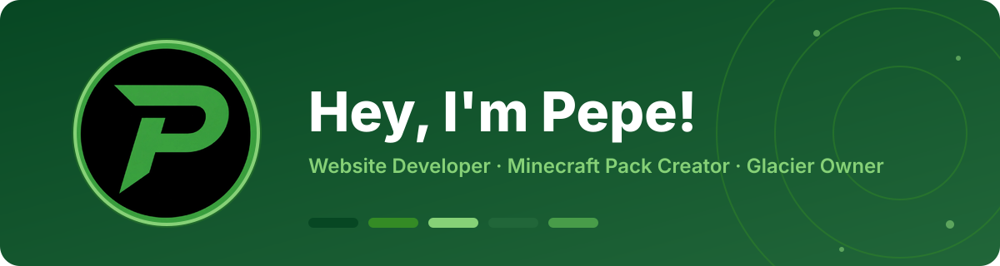

  

  
  
  
  

  <a href="#-about">About</a> ·
  <a href="#-clients">Clients</a> ·
  <a href="#-hud-packs">HUD packs</a> ·
  <a href="#-apps">Apps</a> ·
  <a href="#-open-source">Open source</a> ·
  <a href="#-stack">Stack</a> ·
  <a href="#-socials">Socials</a>

---

## 👋 About

I'm **Pepe**. I run **Glacier Productions**, build the **Glacier Client**, and make HUD packs, Android apps, websites and Discord bots. Every release lives in the library on my portfolio.

| Role | Where |
| --- | --- |
| 👑 **Owner** — Glacier Client & the Glacier hub | [Glacier-Client-BE](https://github.com/Glacier-Client-BE) |
| 🧪 **Studio** — original MCBE experiences & tools | [Nyxora Productions](https://github.com/Nyxora-Productions) |
| 🛠️ **Former developer** — Azelux Client for MCBE | — |

> **Library:** every pack, client and app, with past versions kept → **[pepe.glacierclient.xyz](https://pepe.glacierclient.xyz)**

---

## ❄️ Clients

The flagship is **Glacier Client**. Everything else is the line of clients I've built or rebranded along the way.

<table>
<tr>
<td width="50%" valign="top">

**🧊 Glacier Client** *(flagship)*
The current flagship and home base of Glacier Productions.

**☀️ Solar Client**
Focused on visuals and performance.

**🌪️ Wind Client**
A lighter, faster iteration built on lessons from Void Client.

**🪐 Allay Client**
A round of polish and refinement across the experience.

**🌑 Void Client**
The client that directly followed Pepe Client.

</td>
<td width="50%" valign="top">

**🟡 Sulphur Client**
Another step in the ongoing rebrand and feature journey.

**💡 Project Light**
A bridge release with a leaner, lighter-weight experience.

**🔮 Project Future**
An experimental rebrand exploring a new creative direction.

**🟢 Pepe Client**
Where it all started: the first Bedrock client under the Pepe name.

**🎯 Optifine by Zephyx**
An early Optifine-branded release from the Zephyx era.

</td>
</tr>
</table>

---

## 🧩 HUD Packs

Small, focused packs for the Bedrock HUD. Drop one in and it works.

<b>Show the HUD packs</b>

| Pack | What it does |
| --- | --- |
| Debug HUD | Clean, minimal debug overlay — toggle with **F8** |
| FPS Counter | Lightweight, accurate FPS readout |
| Better Coordinates | Overworld, chunk and Nether coordinates together |
| DirectionHUD | Compact heading indicator |
| Clock & Compass HUD | Time of day and direction at a glance |
| Speedometer | Live movement speed — great for elytra |
| Elytra Pitch | Look-angle readout with a glowing elytra icon |
| Waypoints+ | Set markers by sneaking and clicking |
| Death Coords | Saves exactly where you died |
| ArmorHUD | Worn armor as compact icons on the HUD |
| Better Armor Bar | Armor bar recolored by material |
| OffhandHUD | Offhand item shown beside the main hand |
| InventoryHUD | Live mirror of your inventory |
| Durability Viewer | On-screen durability numbers |
| Level Calculator | XP needed for your next level |
| Totem Pop Counter | Totems popped by each player, over their head |
| Food Stats+ | Hunger and saturation restored per food |
| Better Hover Text | Exact durability and technical tooltips |
| Force Spectator | First-person spectator camera on death |
| Status Effect HUD | Active effects and durations *(discontinued, archive kept)* |

### 🧰 Utility, addons & cosmetics

| Type | Packs |
| --- | --- |
| 🔧 Utility | Anvil Damage Indicator · Animated Crop Growth Highlighter · Armor Hider · Bundle Item Counter · Dynamic 3rd-Person Crosshair · Shiny Pots · Spinning Projectiles · Time Changer |
| ➕ Addons | Experience Tome · Hotbar Refiller · Item Magnet · Void Totem |
| ✨ Cosmetics | Charged Overlay · Halo |
| 📦 Foundation | **Pepe's Assets Pack** — the shared base every Pepe pack builds on |

---

## 📱 Apps

Android apps, built in Kotlin.

| App | What it does |
| --- | --- |
| 🧮 **Calculator** | Scientific calculator with unit tools, history and a home-screen keypad widget |
| 📅 **Calendar** | Agenda and month views, with event alarms that ring in Clock |
| ⏰ **Clock** | Alarms, timers, stopwatch, world clock and bedtime, with a widget |
| 🎵 **Music** | Home, Search, Library and Radio, with a full Now Playing screen |
| 📝 **Notes** | Folders, a private vault, backup and restore, and a widget |
| 🌍 **Translator** | On-device and online translation, camera translation and conversation mode |
| ⛅ **Weather** | Editable dashboard, hourly and daily forecasts, radar and air quality |

---

## 🧑‍💻 Open Source

<b>Indigo Tools & MCBE tools</b>

| Repo | What it does |
| --- | --- |
| [ClientLibrary](https://github.com/Indigo-Tools/ClientLibrary) | Indigo's client library |
| [Indigo-Resources-Pack-Converter](https://github.com/Indigo-Tools/Indigo-Resources-Pack-Converter) | Port texture packs between Java and Bedrock |
| [Indigo-Player-Entity-Merger](https://github.com/Indigo-Tools/Indigo-Player-Entity-Merger) | Merge `player.entity.json` files into one clean output |
| [Indigo-Skin-Pack-Generator](https://github.com/Indigo-Tools/Indigo-Skin-Pack-Generator) | Generate Bedrock skin packs |
| [Indigo-JSON-Utilities](https://github.com/Indigo-Tools/Indigo-JSON-Utilities) | JSON helpers for Bedrock packs |
| [Pepes-Manifest-Generator](https://github.com/PepeOnGithub/Pepes-Manifest-Generator) | Generate `manifest.json` for resource packs |
| [JSON-Obfuscator-MCBE](https://github.com/PepeOnGithub/JSON-Obfuscator-MCBE) | Obfuscate JSON for Minecraft packs |
| [Pepes-MCBE-Translator](https://github.com/PepeOnGithub/Pepes-MCBE-Translator) | Translation helper for MCBE content |
| [3D-Skin-Totem-Generator](https://github.com/PepeOnGithub/3D-Skin-Totem-Generator) | 3D skin totem generator |
| [Cape-Generator](https://github.com/PepeOnGithub/Cape-Generator) | Cape generator |

<b>Web projects</b>

| Repo | What it is |
| --- | --- |
| [Pepes-Portfolio](https://github.com/PepeOnGithub/Pepes-Portfolio) | This portfolio: clients, packs, library and uploads |
| [Geoguessr-Clone-by-Pepe](https://github.com/PepeOnGithub/Geoguessr-Clone-by-Pepe) | Geoguessr-style guessing game |
| [Pepe-s-Geoguessr-Clone](https://github.com/PepeOnGithub/Pepe-s-Geoguessr-Clone) | Earlier Geoguessr clone |
| [Pepe-s-Calculator](https://github.com/PepeOnGithub/Pepe-s-Calculator) | Web calculator |
| [LinguaDash](https://github.com/PepeOnGithub/LinguaDash) | Language practice game |
| [Cicero-Verres-Vokabeln](https://github.com/PepeOnGithub/Cicero-Verres-Vokabeln) | Latin vocabulary trainer |
| [Tschick-Zusammenfassung](https://github.com/PepeOnGithub/Tschick-Zusammenfassung) | Summary of *Tschick* by Wolfgang Herrndorf |
| [Taxi-Ratzeburg](https://github.com/PepeOnGithub/Taxi-Ratzeburg) | Taxi website for Ratzeburg |
| [gaerten-baeume-klettertechnik-seelinger](https://github.com/PepeOnGithub/gaerten-baeume-klettertechnik-seelinger) | Website for a garden and tree-climbing business |

<b>Desktop, bots & other</b>

| Repo | What it is |
| --- | --- |
| [t96-tweaks](https://github.com/PepeOnGithub/t96-tweaks) | Unofficial tweak utility for the FreeWolf T96 KBM converter (Tauri + Svelte) |
| [OptiDows](https://github.com/PepeOnGithub/OptiDows) | Windows optimization tool (Rust) |
| [nyxora-tools](https://github.com/PepeOnGithub/nyxora-tools) | Minecraft toolbox apps for Windows and Android |
| [glk-sof-windows](https://github.com/PepeOnGithub/glk-sof-windows) | Experimental Windows audio driver for Intel Gemini Lake Chromebooks |
| [pepe-bot](https://github.com/PepeOnGithub/pepe-bot) | Discord bot (Python) |
| [Pepes-Discord-Bot-Template](https://github.com/PepeOnGithub/Pepes-Discord-Bot-Template) | Python Discord bot template |
| [plugin-template](https://github.com/PepeOnGithub/plugin-template) | Vendetta plugin template with pnpm monorepo support |

---

## 🛠️ Stack

**Languages I know:** HTML · CSS · JavaScript · Python · C# · Java
**Learning:** Rust · C++

  
  
  
  
  
  
  
  
  
  
  
  
  
  

---

## 🌐 Socials

<table>
<tr>
<td align="center" width="25%"><a href="https://youtube.com/@PepeOnYoutube"><b>▶ YouTube</b></a> @PepeOnYoutube</td>
<td align="center" width="25%"><a href="https://x.com/_pepeyt_"><b>𝕏 X</b></a> @_pepeyt_</td>
<td align="center" width="25%"><a href="https://www.instagram.com/pepeonmeta/"><b>📷 Instagram</b></a> @pepeonmeta</td>
<td align="center" width="25%"><a href="https://www.tiktok.com/@pepeontt"><b>🎵 TikTok</b></a> @pepeontt</td>
</tr>
<tr>
<td align="center"><a href="https://discord.com/invite/t9BgvskwJ2"><b>💬 Community Discord</b></a> Sneak peeks & votes</td>
<td align="center"><a href="https://discord.glacierclient.xyz/"><b>❄️ Glacier Hub</b></a> Glacier Productions</td>
<td align="center"><a href="https://mcpedl.com/user/pepeonmcpedl/"><b>📦 MCPEDL</b></a> Pack downloads</td>
<td align="center"><a href="https://www.curseforge.com/members/pepeoncf/projects"><b>🔥 CurseForge</b></a> Projects</td>
</tr>
<tr>
<td align="center"><a href="https://github.com/PepeOnGithub"><b>🐙 GitHub</b></a> Code</td>
<td align="center"><a href="https://ko-fi.com/pepeonkofi"><b>☕ Ko-fi</b></a> Support</td>
<td align="center"><a href="https://paypal.me/PepeOnPayPal"><b>💳 PayPal</b></a> Donate</td>
<td align="center"><a href="https://discord.com/users/653986158552023050"><b>👤 Discord DM</b></a> Pepe#0001</td>
</tr>
</table>

---

## 📈 GitHub Stats

---

  

